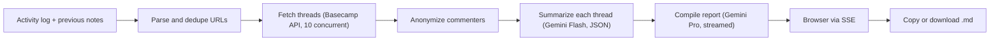

# Call Notes Generator

Walk into every client call with polished notes: paste a week of Basecamp activity and get a client-ready report in your agency's voice.

> Built by **Satya Janghu**, a digital marketing expert specializing in SEO, AI search, and organic growth marketing. [getsatya.com](https://getsatya.com) · [satya@getsatya.com](mailto:satya@getsatya.com)


## Why it exists

Before every client call, an agency account manager re-reads a week of Basecamp threads and writes a status summary the client can actually follow. That takes 30 to 60 minutes per client, every week, and the result varies with whoever wrote it. Call Notes Generator is built to get that down to under 5 minutes, with the same structure and brand voice in every report.

## What it does

- **Paste a log, get a report.** Paste the Basecamp activity log and receive a categorized Markdown report, streamed live as it is written.
- **Writes in the agency's voice.** A built-in style guide addresses the client as "you", removes hedging and buzzwords, and keeps sentences short.
- **Keeps team names out of AI.** Commenters become "Person A", "Person B" before any text reaches the model, and the prompts strip @mentions and references to chat or task tools.
- **Remembers the last call.** Paste the previous notes and the report focuses on what changed. Tasks stuck In Progress for 3 or more calls get flagged.
- **Drops stale noise.** Completed "zombie" tasks, unchanged items and admin-only activity are excluded automatically.
- **Sorts work the way clients think.** Six service categories (SEO/DEV, Copywriting, Linkbuilding, PPC, Email Marketing, Social Media) and five statuses (Completed, Live, In Progress, Blocked, Upcoming).
- **Surfaces deliverables.** Copywriting threads produce page-level Live, Doc and Test links, ready for the client to click.
- **Ready to send.** Copy to Clipboard or Download .md drops the result straight into the client email.

## How it works



1. **Parse.** The app pulls every Basecamp todo and message URL out of the pasted log, drops list and project links, and removes duplicates. The UI previews the count before anything runs.
2. **Fetch.** Each thread and its comments load in parallel from the Basecamp 4 API. A thread whose comments can't be loaded still goes through, and a deleted one becomes a "Thread Not Found" placeholder.
3. **Summarize.** Gemini 2.5 Flash turns each thread into a schema-enforced JSON record: category, status, a 1–3 sentence client-facing description, copy links and a stale-task flag.
4. **Compile.** Gemini 2.5 Pro groups the records by category and status, runs a quality checklist and a final style pass, and streams the Markdown back to the browser over Server-Sent Events.

The full design is in [docs/ARCHITECTURE.md](docs/ARCHITECTURE.md).

## Engineering highlights

- **Tiered models for cost and quality.** Many small extraction jobs go to Flash (temperature 0.3, 2 concurrent). The single report that needs judgment goes to Pro (temperature 0.2). Both models are overridable by env var.
- **Built for API quotas.** Basecamp calls are capped at 10 concurrent with `p-limit`, retried twice, and back off on HTTP 429 using the `Retry-After` header. Gemini calls retry 4 times with exponential backoff (1s, 2s, 4s, 8s) and jitter, and never retry safety blocks or timeouts.
- **Hard timeouts everywhere.** 30s per Basecamp request (cancelled with `AbortController`), 120s per Gemini call, 180s for the full compile stream, 5 minutes in the browser.
- **Token budgeting.** 120,000 characters per pasted input and 20,000 per thread, split one third description and two thirds comments. Low-value comments ("thanks", "+1") are filtered, and recent comments get 2x weight (last 7 days) or 1.5x (last 14 days).
- **Resilient output.** JSON repair runs in 3 stages, and invalid categories or statuses snap to safe defaults. If a thread can't be summarized, a keyword-based fallback still places it in the report.
- **Codified editorial rules.** 21-day zombie-task threshold, a 14-day "never exclude" window, 7-day recency for In Progress, and client-visible shared projects capped at one sentence of 15 words.
- **Local-only by design.** The server binds to `127.0.0.1`, OAuth uses a one-time `state` value, tokens refresh 5 minutes before expiry behind a mutex, `.env` is written with 0600 permissions, request bodies are capped at 5 MB, and browser-facing errors are sanitized.
- **Test suite.** 226 Vitest tests across 11 files cover the routes (via supertest), OAuth and token logic, the Basecamp client, orchestration, SSE, parsing, JSON repair, config and validation. TypeScript runs in strict mode.

## Tech stack

| Layer | Technology |
|---|---|
| Runtime | Node.js 22+, TypeScript 5.9 (strict, ESM) |
| Server | Express 5, Server-Sent Events |
| AI | Google Gemini 2.5 Flash and 2.5 Pro via `@google/genai` |
| Integrations | Basecamp 4 REST API with OAuth 2.0 |
| Reliability | p-limit, p-retry, AbortController timeouts |
| Frontend | Vanilla HTML, CSS and JS with dark mode, no build step |
| Testing | Vitest, supertest, v8 coverage |

## Project evolution

**Started as** a product spec for a common agency pain: account managers spending up to an hour per client turning Basecamp threads into pre-call notes. The goal was a single `callnotes` command that opens a local app, takes a pasted activity log and returns a report in the agency's house style.

**Became** a full local web app with a 3-step setup wizard (register the Basecamp app, connect via OAuth, add a Gemini key) and a four-phase pipeline that streams progress and the report live. It now also carries continuity from the previous call, detects stuck and stale tasks, tightens copy for client-visible projects, and extracts page-level links from copywriting work.

## Roadmap

- Pick a Basecamp project directly instead of pasting the activity log.
- Output to Google Docs and Notion.
- Per-client report templates.
- Report history.
- Batch mode for multiple clients.
- Multi-provider models, such as an OpenAI structured-output tier alongside Gemini.

## Running it locally

**Prerequisites:** Node.js 22+, a Basecamp 4 account that can register an integration at [launchpad.37signals.com](https://launchpad.37signals.com/integrations), and a Gemini API key from [Google AI Studio](https://aistudio.google.com/apikey).

```bash
git clone https://github.com/satya-janghu/call-notes-generator.git
cd call-notes-generator
npm install
npm run build
npm start          # or: npm install -g . && callnotes
```

The app opens at `http://localhost:3000` (or the next free port). The setup wizard writes your `.env`: Basecamp client ID and secret (redirect URI `http://localhost:3000/auth/callback`), OAuth tokens, and `GEMINI_API_KEY`. Optional settings from [.env.example](.env.example): `GEMINI_SUMMARIZE_MODEL`, `GEMINI_COMPILE_MODEL`, `AGENCY_NAME`, `PORT`.

Run the tests with `npm run test:run`, or start a hot-reload dev server with `npm run dev`. Full steps are in [docs/INSTALLATION.md](docs/INSTALLATION.md).

## Documentation

- [Architecture](docs/ARCHITECTURE.md): pipeline, models, reliability, security and code map.
- [Product requirements](docs/PRD.md): goals, UI flow, API endpoints and acceptance criteria.
- [Processing logic](docs/PROCESSING.md): status rules, stale-task exclusion and category assignment.
- [AI prompts](docs/AI_PROMPTS.md): how both prompt tiers are designed, with example output.
- [Style guide](docs/STYLE_GUIDE.md): the brand voice and report format.
- [Installation](docs/INSTALLATION.md): setup, configuration and troubleshooting.

## About the author

> Built by **Satya Janghu**, a digital marketing expert specializing in SEO, AI search, and organic growth marketing. [getsatya.com](https://getsatya.com) · [satya@getsatya.com](mailto:satya@getsatya.com)

Satya streamlines agency reporting so account managers can spend call prep on the conversation with the client rather than on the write-up.

## License

All rights reserved. See [LICENSE](LICENSE).
